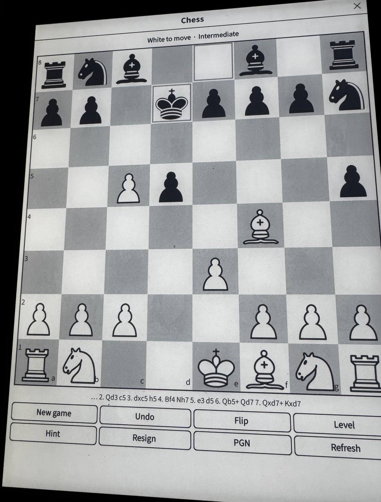
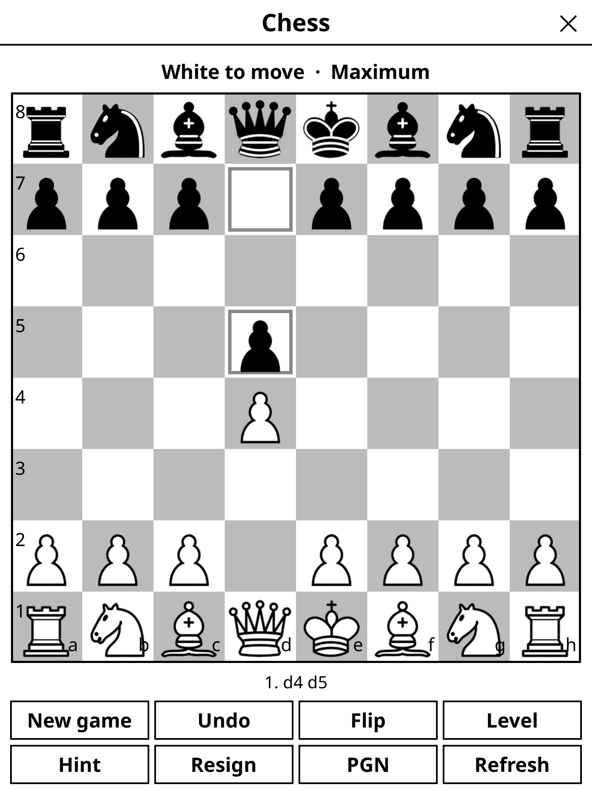

# Kobo Chess


Play chess against a built-in engine on a Kobo, as a KOReader plugin, with a
NickelMenu entry so it opens in two taps from the home screen. Runs on an
Elipsa (2021) and on a 2013 Aura alike.

<p align="center">
  
  <br>
  <sub>On the device. This photo predates the current piece set — see below.</sub>
</p>

Built and tested for a **Kobo Elipsa (v1)** — 1404×1872, 10.3". The layout is
computed from the screen size rather than hardcoded, so it adapts to other
Kobos, but the Elipsa is what it was checked on.

The whole thing is Lua: the engine has no native code, so there is no
toolchain to build and nothing to cross-compile for the device.


<details>
<summary>The same board, captured from the desktop build at the Elipsa's exact resolution</summary>



</details>

## What it does

- Play as White or Black against the engine, six strength levels.
- **Two engines.** The built-in one is pure Lua and always present.
  **Stockfish** can be installed alongside it and picked under
  **Options → Engine**; see [Engines](#engines).
- **Two-player mode** — pick "Two players (no engine)" under New game and the
  engine stays out of it entirely. Undo then takes back a single ply rather
  than a move and its reply, and resigning applies to whoever is to move.
  The device is meant to lie flat between the players, so the pieces of
  whichever side is drawn at the top are turned 180° and read the right way
  up from the far side of the table. **Flip** swaps which side that is.
- **A clock**, for two-player games — 3|2 through 30|0, with increment.
  Making a move presses it; there is no button to forget. Each player's
  clock sits at their end of the board, the far one turned over like their
  pieces, and tapping either clock pauses and resumes.
- Tap a piece to pick it up; legal destinations appear as dots, captures as
  rings. Tap again to move.
- One row of buttons — **Game · Undo · Hint · Flip · Refresh · Options** —
  with everything that is not needed mid-game behind the two menus:

  | | |
  |---|---|
  | **Game ▾** | New game · Start/pause clock · Resign · Export PGN · Copy FEN |
  | **Options ▾** | Piece set · Engine · Level · Clock · Screen refresh · Coordinates on/off |

- **Refresh** clears e-ink ghosting on demand; hold it to set how often the
  board does that by itself (every move … every 12, or never).
- Two piece sets ship, and **Options → Piece set** switches between them
  without restarting. Any further set dropped into `pieces/` appears there too.
- The game is saved continuously, so it survives sleep, a KOReader restart,
  and a flat battery.
- Full rules: castling, en passant, promotion (including underpromotion),
  the fifty-move rule, threefold repetition and insufficient material.

## Prerequisites

- **[KOReader](https://github.com/koreader/koreader)** on the Kobo — the
  plugin runs inside it. Install with
  [KOReader's one-click installer](https://github.com/koreader/koreader/wiki/Installation-on-Kobo-devices)
  or via NickelMenu. No jailbreak; a factory reset removes everything.
- **[NickelMenu](https://pgaskin.net/NickelMenu/)** — optional, only for the
  **Chess** entry on the Kobo home screen (`--with-nickelmenu`).
- For the SSH install path, an SSH server on the device. A stock Kobo has
  none; use KOReader's (*Network → SSH server*: port 2222, user `root`,
  blank password), and on your computer `sshpass` because plain `ssh`
  refuses a blank password:

  ```sh
  SSH="sshpass -p '' ssh -p 2222" SCP="sshpass -p '' scp -P 2222" \
      ./install.sh root@<kobo-ip> --with-nickelmenu
  ```

  Or skip SSH entirely: plug the Kobo in and use the USB path below.
- `python3` on your computer, only if you need to regenerate the piece images.

## Installing

You need [KOReader](https://github.com/koreader/koreader) on the device
already. NickelMenu is optional.

```sh
python3 tools/gen_pieces.py        # only if pieces/ is empty
./install.sh kobo                  # over SSH; "kobo" is any ssh target
./install.sh /media/you/KOBO       # or to a USB-mounted device
```

Add `--with-nickelmenu` to also put **Chess** on the Kobo home screen menu.

Then, in KOReader: **≡ menu → Tools → Chess**.

### The NickelMenu entry

`install.sh --with-nickelmenu` copies two files:

| File | Destination |
|---|---|
| `nickelmenu/kobochess` | `/mnt/onboard/.adds/nm/kobochess` |
| `nickelmenu/kobochess-launch.sh` | `/mnt/onboard/.adds/kobochess-launch.sh` |

The launcher touches a flag file
(`.adds/koreader/settings/kobochess_autostart`) and starts KOReader. The
plugin checks for that flag on startup, deletes it, and opens the board
instead of the file browser — so a crash can never leave the device stuck
opening Chess.

## How it plays

Levels map to a search depth and a time budget. The last two columns are
measured on the Elipsa itself, not estimated:

| Level | Depth cap | Time | Reached on device | Time taken |
|---|---|---|---|---|
| Beginner | 1 | 0.5s | 1 | instant |
| Easy | 2 | 1s | 2 | instant |
| Casual | 3 | 2s | 3 | 0.2s |
| Intermediate | 5 | 4s | 5 | 0.9s |
| Strong | 8 | 10s | 7 | 10.1s |
| Maximum | 20 | 25s | 8 | 25.0s |

The Elipsa manages roughly 27,000 nodes/second in search and 125–165k in
plain move generation, under LuaJIT's ARM JIT. Intermediate replies in about
a second, which is the level to use for a normal game; Strong and Maximum
spend their whole budget and are worth it only if you want to think as well.

The weaker levels add a random offset to each candidate move's score, so they
lose in varied, human-ish ways rather than playing the same slightly-worse
move every time. They will still not hang a queen for no reason, and no level
will throw away a forced mate.

Search is alpha-beta with iterative deepening, a transposition table,
quiescence search, null-move pruning, late move reductions, killer/history
move ordering, and a tapered material + piece-square evaluation.

## Engines

The built-in engine is the pure-Lua one described above: no binary, nothing
to install, and it is what the plugin uses unless told otherwise.

Any UCI engine can be added beside it. Each lives in its own folder under
`kobochess.koplugin/engines/`, and whatever is found there appears in
**Options → Engine**:

```
engines/
  stockfish/
    engine            the executable -- the executable bit is what
                      identifies it, so the name does not matter
    nn-….nnue         its network, if it needs one
  stockfish-classic/
    engine            a second engine is just a second folder
```

Nothing under `engines/` is tracked by git. Stockfish is GPLv3 and its
network alone is over a hundred megabytes, so it is built rather than
committed:

```sh
tools/build_stockfish.sh            # Stockfish 18 + NNUE, for a Kobo with 1 GB
tools/build_stockfish.sh --classic  # Stockfish 11, for a Kobo with 256 MB
tools/build_stockfish.sh --native   # or for this machine, to test in the emulator
./install.sh kobo                   # every engine in engines/ travels with the plugin
./install.sh kobo --engine stockfish-classic   # or just the one named
```

**Two builds, because memory.** Stockfish 18 reserves about 131 MB for its
big neural network the moment it starts, before it has read a single file.
On an Elipsa (1 GB) that is nothing. On a **Kobo Aura** (i.MX50, a single
Cortex-A8, 256 MB with KOReader already resident) the allocation fails with
`ENOMEM` and the engine aborts with `std::bad_alloc` — no rebuild of
Stockfish 18 can fix that. Stockfish 11 is the last release with classical
evaluation: no network, a few megabytes of RAM, and on the Aura it still
reaches depth 14 in three seconds at about 70k nps — far stronger than the
device needs. `--classic` builds it into `engines/stockfish-classic/`, beside
the other, so one checkout serves both kinds of device; `install.sh --engine`
picks which goes where (`--no-engines` for the built-in only). Whatever is
not chosen is removed from the device, so a device never carries an engine
that cannot run on it.

One small difference: Stockfish 11's `UCI_Elo` bottoms out at 1350 rather
than 1320, so its **Beginner** level is a shade stronger than Stockfish 18's.

The script needs no root: it fetches a self-contained ARM toolchain into
`local/` on first use, cross-compiles Stockfish static against musl — a Kobo's
own glibc is far too old to link against — and keeps the network as a separate
file rather than the 110 MB binary that embedding it would produce.

It also applies `tools/stockfish-armv7-neon.patch`, one line: Stockfish's
32-bit ARM NEON path does not compile, because a helper standing in for an
instruction that 32-bit ARM lacks is declared returning the wrong vector type.
The build fails loudly if that patch stops applying and the problem has not
been fixed upstream, rather than quietly producing something untested.

**How the six levels map.** An external engine is far too strong to play
straight, so the lower levels ask it to play badly on purpose, through
`UCI_LimitStrength` and `UCI_Elo` — a rating target the engine implements
itself, losing in more human-looking ways than simply searching less deeply.
Only **Maximum** lets it off the leash. The level names are the same either
way, so the menu reads the same whichever engine is selected.

**If an engine will not start** — the wrong architecture, a missing network,
a folder with nothing runnable in it — the plugin says so, switches back to
the built-in engine, and plays the move it was in the middle of, so a bad
install cannot leave a game stuck waiting for a move that is never coming.

## Four traps worth knowing about

Each of these produced a bug that looked like something else entirely, so they
are written down rather than rediscovered.

**`execvp` runs the shell on a binary it cannot execute.** Hand it an
executable for the wrong architecture and it does not simply fail: on
`ENOEXEC` it falls back to passing the file to `/bin/sh`, which reads the
machine code as a shell script and reports a syntax error somewhere in the
middle of it. The error names the file and a line number, so it reads like a
corrupt script rather than an ARM binary on an x86 machine. `execv` does not
do this — it fails, which is the truth. Related: KOReader's
`terminateSubProcess` kills but does not reap, so an engine left that way
lingers as a zombie until something calls `isSubProcessDone` on it, which
cannot be done in one go because the process takes a moment to die.

**A search that yields to the UI must run on a copy of the board.** The engine
explores by making and unmaking moves on the board it is given, and the front
end runs it in a coroutine that yields every 50 ms so the screen stays alive.
Hand it the live board and any repaint landing mid-search draws the
hypothetical position the engine is currently standing in — pieces on strange
squares, captured pieces missing, fixed by the next refresh. At the front
end's tick interval, *every* yield lands on a disturbed board; `search_test.lua`
asserts both that (as a control, so the test can fail) and that a search on a
clone leaves the game board untouched.

**Never pass `radius = Size.radius.button` to a `Button`.** Button uses that
exact value as a sentinel: on tap it adds the rounding, and on release
`_undoFeedbackHighlight` checks `radius == Size.radius.button` to decide
whether to remove it again. Setting it yourself makes the highlight and the
unhighlight take mismatched branches, which clears the radius permanently and
inverts the label colour to white-on-white. The button appears to lose its
corners and then vanish, and no amount of refreshing brings it back, because
nothing is wrong with the refresh. Leave `radius` nil.

**`CenterContainer` never updates `dimen.x`/`dimen.y`.** Its dimen holds the
size it was built with, so handing it to `UIManager:setDirty` as a refresh
region updates a rectangle in the top-left corner of the screen instead of the
widget. `chesswidget.lua` subclasses it to record the paint position.

## Layout of the project

```
kobochess.koplugin/       what gets copied to the device
  main.lua                menu registration, autostart, save/restore
  chesswidget.lua         the full-screen UI
  boardview.lua           the 8x8 board, painted directly to the blitbuffer
  kobochess/
    board.lua             0x88 board, move generation, make/unmake, FEN
    eval.lua              evaluation
    search.lua            alpha-beta search
    game.lua              move history, results, save format, PGN
    clock.lua             the two countdowns
    engines.lua           which engines are installed
    engine_lua.lua        the built-in engine, behind the shared interface
    engine_uci.lua        an external engine, over a pipe
  engines/<name>/         an installed UCI engine (not tracked)
  pieces/<set>/           twelve piece images per set; pick one under Options
tools/gen_pieces.py       draws a piece set from scratch
tools/import_pieces.py    builds a piece set from a sprite sheet
tools/build_stockfish.sh  cross-compiles Stockfish for the device (--classic for 256 MB Kobos)
test/perft.lua            move generation correctness
test/search_test.lua      tactics, self-play, interruption, speed
nickelmenu/               the home-screen menu entry
install.sh                deploy to the device
```

## Tests

Move generation is verified with [perft](https://www.chessprogramming.org/Perft)
against the six standard positions — this is the only real proof that the
rules are implemented correctly:

```sh
luajit test/perft.lua 2      # arg = seconds allowed per position
luajit test/search_test.lua
luajit test/clock_test.lua
```

The clock takes "now" as an argument rather than reading it, the same way the
search does, so `clock_test.lua` makes three minutes pass in a microsecond and
checks the increment, the flag and the save format exactly.

`perft.lua` also checks that make/unmake restores the position exactly and
that the incrementally updated Zobrist hash matches a full recomputation.

`test/ondevice.lua` runs the engine on the Kobo itself, using KOReader's own
LuaJIT and without disturbing the running app — it is how the level timings
above were measured, and it confirms the ARM build behaves identically:

```sh
scp -P 2222 test/ondevice.lua root@<kobo>:/tmp/
ssh -p 2222 root@<kobo> \
    'cd /mnt/onboard/.adds/koreader && ./luajit /tmp/ondevice.lua'
```

## Notes on e-ink

The screen is the slow part, not the engine, so the UI is built around
touching it as little as possible:

- Every board change computes which squares actually changed and refreshes
  only their bounding box.
- Moves refresh as `"partial"`, selection highlights as `"ui"`. The
  distinction matters: `"partial"` counts towards UIManager's automatic
  flashing refresh and so cleans up the ghosts that moving pieces leave,
  while `"ui"` stays crisp and never flashes — the right trade for a
  highlight that changes on every tap.
- A full flashing refresh happens on a new game, every N moves, and whenever
  **Refresh** is tapped. The default of 3 is not a guess — it is what was
  found to clear the Elipsa's panel in practice; hold **Refresh** to change
  it if your device wants more or less.
- The engine search runs inside a coroutine that yields every 50 ms, so the
  screen and the buttons stay responsive while it thinks instead of the app
  freezing for the length of the search.
- While thinking, the status line updates at most every 1.5 s, because each
  update costs a repaint.
- The clock repaints once a second while it runs, but only the line whose
  number actually changed, and always as `"ui"` — a mode that counted towards
  the automatic flashing refresh would have the screen blinking its way
  through the game. It stops on its own when the board is closed, when the
  device suspends, and when the game ends.
- **Night mode** needs special handling. KOReader inverts the whole screen on
  its way to the panel, and `ImageWidget` compensates by inverting each
  image's entire bounding rectangle — transparent margins included, which
  paints an inverted box of board behind every piece. The board therefore
  loads the piece bitmaps itself and inverts the *blitbuffer* (a per-pixel
  flag that leaves the alpha alone), and pre-inverts its own squares and
  lines. The result is a board that still looks like a board, inside a dark
  UI.

## Piece artwork

A set is a folder of twelve PNGs under `kobochess.koplugin/pieces/`, and the
plugin offers whichever folders it finds there under **Options → Piece set**.
Two ship:

| Set | Where it comes from |
|---|---|
| **Vecteezy** | a stock icon set, the default |
| **Drawn** | generated by `tools/gen_pieces.py`, no third party involved |

**Piece artwork by [Vecteezy.com](https://www.vecteezy.com/)**, used under the
Vecteezy Free License, which requires that attribution. It is credited here,
and in the plugin's description inside KOReader.

The Vecteezy EPS itself is *not* in this repository: a stock licence covers
using an asset, not redistributing the asset itself. To rebuild that set,
download it, rasterise the EPS and run the importer:

```sh
gs -dSAFER -dBATCH -dNOPAUSE -dEPSCrop -sDEVICE=pngalpha -r144 \
   -o sheet.png chess-icon-set.eps

python3 tools/import_pieces.py --sheet sheet.png --grid 4x3 \
    --order wk,wq,wr,wb,wn,wp,bk,bq,br,bb,bn,bp --set vecteezy
```

The importer removes the sheet's background with a flood fill inwards from the
borders — a plain colour key cannot work, because the white pieces are white
inside as well as out — then scales all twelve by a single shared factor and
stands them on a common baseline. `--grid` and `--order` describe the sheet's
layout, since sheets disagree about both. Icon sets tend to draw every piece
the same size, so the importer also restores the usual hierarchy: the pawn
ends up shorter than the king rather than standing eye to eye with it.

The drawn set needs nothing but the script, and being vector-defined it
re-renders crisply at any size:

```sh
python3 tools/gen_pieces.py --size 320
```

### Adding a set of your own

`--set NAME` writes to `pieces/NAME/`, which is all it takes for the set to
appear in the menu after a reinstall:

```sh
python3 tools/import_pieces.py --sheet mysheet.png --grid auto --rows 2 \
    --order wp,wk,wq,wb,wn,wr,bp,bk,bq,bb,bn,br --set my-icons
```

`--grid auto` is for sheets that are not on a grid at all — icons laid out by
eye, with uneven gaps and a wide margin. It finds the rows, and the icons
inside each row, by projecting the ink onto each axis, which does not care
about spacing. Pieces drawn with a detached plinth still count as one icon;
JPEG speckle in the background counts as none.

Only the two sets above are tracked by git. Anything else under `pieces/` is
gitignored, so a set built from artwork that cannot be redistributed still
gets copied to the device by `install.sh` like any other, without ever
reaching the repository.

## Development

`test/` runs against plain LuaJIT with no KOReader present. For the UI, the
desktop build of KOReader runs the plugin unmodified:

```sh
# from a KOReader linux build directory
cp -r kobochess.koplugin <koreader>/plugins/
EMULATE_READER_W=1404 EMULATE_READER_H=1872 ./koreader.sh ~/books
```

That is how the screenshots and the layout were checked at the Elipsa's exact
resolution. Running it under `Xvfb :99 -screen 0 1404x1872x24` makes it
headless, and `tools/emulator_tap.py` then drives it by chess square:

```sh
python3 tools/emulator_tap.py e2 e4 s10 g1 f3
```

which is enough to play through a game, exercise the buttons and screenshot
the result without touching a device.

`local/` is for working material that is deliberately not tracked: source
artwork whose licence does not allow redistributing it, device photos, and the
desktop KOReader build. It is gitignored; nothing in the plugin depends on it.

## License

GNU Affero General Public License v3.0 — see [LICENSE](LICENSE).

KOReader itself is AGPL-3.0, and this is a plugin for it, so the same terms
apply here.

Two things this licence does *not* cover, because they are not mine to
license:

- **Piece artwork in `pieces/vecteezy/`** is by [Vecteezy.com](https://www.vecteezy.com/),
  used under the Vecteezy Free License with the attribution given above. The
  `drawn` and `line-icons` sets are generated by `tools/gen_pieces.py` and are
  covered by the AGPL like the rest of the plugin.
- **Stockfish** is GPLv3 and is not distributed here at all. `tools/build_stockfish.sh`
  builds it from upstream source on your own machine; nothing under `engines/`
  is tracked.
